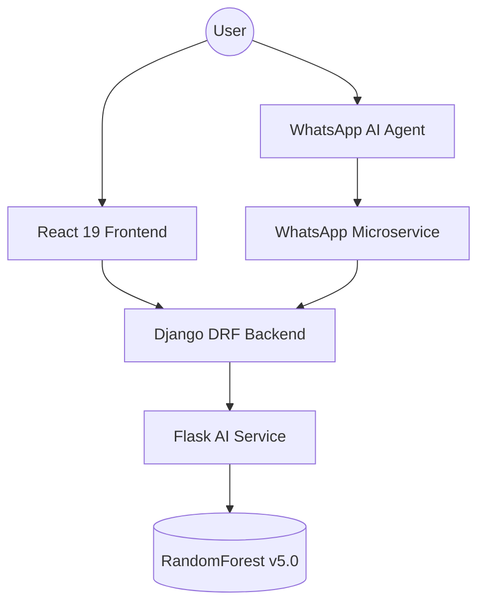

# 🔬 MedEra - Medical Management SaaS App

[](https://www.djangoproject.com/)
[](https://react.dev)
[](https://www.python.org/)
[](https://postgresql.org)
[](https://docker.com)

**MedEra** is a high-fidelity, cinematic SaaS platform designed for solo practitioners and small clinics. It bridges the gap between traditional medical management and the future of biological data and AI-driven diagnostics.

## ✨ Features

- **Cinematic UI**: A "Midnight Luxe" interface providing a premium experience for medical professionals.
- **AI Diagnostics**: High-performance Flask microservice featuring a calibrated RandomForest diagnostic engine for predictive healthcare.
- **WhatsApp Concierge**: Intelligent bot allowing patients to book appointments, check availability, and register via natural language (Text or Voice).
- **Secure Backend**: Robust Django Rest Framework core handling authentication, scheduling, billing, and role management.
- **Complete Orchestration**: Fully Dockerized for seamless deployment across environments.

## 🚀 Quick Start

### Prerequisites

Ensure you have **Docker** and **Docker Compose** installed on your system.

### Installation

1. Clone the repository:
```bash
git clone https://github.com/ali-harti/MedEra-Medical-Management-SaaS-App.git
cd MedEra-Medical-Management-SaaS-App
```

2. Configure environment variables:
```bash
cp .env.example .env
```

3. Spin up the infrastructure using Docker Compose:
```bash
docker-compose up --build
```

### Manual Setup (Without Docker)

You can also run the components individually:

- **Backend (Django)**: `cd backend && pip install -r requirements.txt && python manage.py runserver`
- **Frontend (React)**: `cd Medera-Frontend && npm install && npm run dev`
- **WhatsApp Service**: `cd whatsapp_service && pip install -r requirements.txt && python app/main.py`

## 🧠 Tech Stack & Architecture

- **Backend Framework**: Django 4.2, Django Rest Framework (DRF) 3.14
- **Frontend Stack**: React 19, Vite, Tailwind CSS v3.4, GSAP 3 (Cinematic Animations)
- **AI Service**: Python, Flask, RandomForestClassifier, Scikit-learn
- **NLP & Chat**: OpenAI GPT-4o-mini
- **Database Engine**: PostgreSQL 15, Redis 7
- **Infrastructure**: Docker, Nginx, Celery



## 📂 Project Structure

```text
Medera-Latest/
├── Medera-Frontend/          # React 19 SPA Cinematic UI
├── backend/                  # Django REST framework core
├── ai_service/               # Flask machine learning diagnostic microservice
├── whatsapp_service/         # NLP-powered WhatsApp chatbot
├── docker-compose.yml        # Orchestration
└── README.md                 # Project documentation
```

## 📝 License

This project is open-source and available under the [MIT License](LICENSE).

**Developed by Ali Harti**
