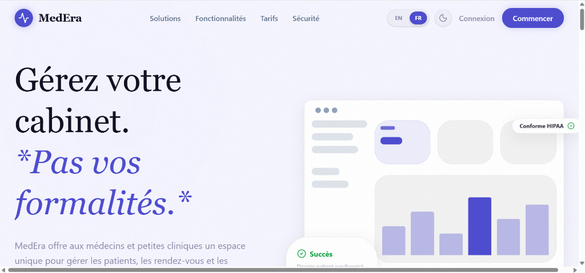
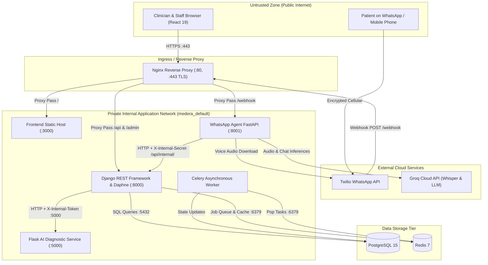

# 🔬 MedEra — Medical Management SaaS Platform


MedEra is a multi-tenant clinical management SaaS application designed for solo medical practitioners and small private clinics. The platform consolidates electronic health records (EHR), multi-role scheduling, consultation documentation, digital prescription issuance with PDF generation, invoicing, and an auxiliary AI-driven differential diagnostic engine alongside a WhatsApp booking concierge.

> **Important Deployment Notice**: MedEra is an engineering portfolio demonstration and reference implementation. It is **not deployed publicly** and is intended to be executed in an isolated local environment using Docker Compose. It has not undergone formal clinical certification, CNDP regulatory filing, or HIPAA/HDS compliance audits.

---

## 1. Demonstration Media

<p align="center">
  
</p>

| Interface View | Screenshot Preview |
| :--- | :--- |
| **Landing & Clinic Portal Overview** | `docs/screenshots/medera-landing.png` |
| **Practitioner Dashboard** | `docs/screenshots/dashboard-overview.png` *(Upcoming)* |
| **Consultation & Clinical AI Differential Engine** | `docs/screenshots/consultation-ai-analysis.png` *(Upcoming)* |
| **Digital Prescription & PDF Generation** | `docs/screenshots/prescription-generator.png` *(Upcoming)* |
| **WhatsApp Conversational Triage** | `docs/screenshots/whatsapp-booking-flow.png` *(Upcoming)* |

---

## 2. Core Functional Modules

- **Practitioner & Staff Dashboard**: Real-time Key Performance Indicators (KPIs), daily appointment timelines, consultation queues, and operational metrics.
- **Appointment Lifecycle**: State-machine driven scheduling (`REQUESTED` → `PLANNED` → `CONFIRMED` → `IN_PROGRESS` → `COMPLETED` / `CANCELLED`), calendar views, and automated reminder dispatch via Celery.
- **Consultation Records & EHR**: Clinical dossiers with structured symptom capture, consultation histories, and immutable post-finalization records.
- **Diagnostic AI Advisory**: Machine-learning assisted differential diagnosis ranking potential conditions with ICD-10 mapping, calibrated confidence scores, and feature explainability.
- **Prescription System**: Medication line management, dosage scheduling, cancellation tracking with visual watermarking, and server-side PDF generation.
- **Billing & Invoicing**: Structured invoice creation, payment status tracking (`PENDING`, `PAID`, `CANCELLED`), and revenue summaries.
- **WhatsApp Concierge**: Conversational assistant processing patient registration, doctor discovery, appointment requests, and audio voice messages via automated speech-to-text transcription.

---

## 3. Architecture & Trust Boundaries

The system is partitioned into five internal services, two persistent data stores, and external third-party communication APIs.



### Data Flow Descriptions

1. **Client Interaction Flow**: Browser requests reach Nginx over TLS. Static SPA assets are proxied from the Vite dev server, while API requests (`/api/`) route to the Django Daphne ASGI application.
2. **AI Diagnostic Request Flow**: A doctor finalizes consultation symptoms in Django. The backend initiates an internal HTTP POST to `ai_service:5000/api/predict` transmitting clinical parameters accompanied by an `X-Internal-Token` header.
3. **WhatsApp Concierge Flow**: Twilio forwards incoming patient messages to `/webhook`. The FastAPI agent reads conversational context from memory, contacts Groq Cloud for LLM inference / audio transcription, and executes backend operations through the internal gateway `/api/internal/chatbot-gateway/` using a shared service secret.
4. **Asynchronous Background Processing**: Appointment reminder tasks are scheduled via Celery Beat, persisted in Redis, and executed by Celery workers to dispatch SMS/Email notifications.

---

## 4. Application Security & Threat Model

### 4.1 Asset Inventory & Threat Actors

- **Protected Assets**:
  - Patient Health Information (PHI) and Personally Identifiable Information (PII): Full names, phone numbers, identity numbers (CIN), dates of birth, consultation clinical notes.
  - Diagnostic Records & Prescriptions: Doctor observations, differential diagnoses, prescribed medication regimens.
  - Billing Records: Financial transactions, invoice balances, patient payment statuses.
  - Authentication Credentials & Tokens: Passwords, JWT signing secrets, inter-service authentication tokens.
- **Threat Actors**:
  - *Malicious Public Adversary*: External unauthenticated entity attempting data exfiltration, token brute-forcing, or injection attacks.
  - *Malicious / Compromised Tenant (Clinic)*: Authenticated practitioner or secretary attempting horizontal privilege escalation into another clinic's confidential patient records.
  - *Untrusted Patient*: Authenticated patient attempting vertical privilege escalation into doctor consultation controls or other patients' medical histories.
  - *Eavesdropper*: Network observer attempting to intercept unencrypted traffic in transit.

### 4.2 STRIDE Threat Assessment

| Threat Category | Potential Threat | MedEra Defense Implementation | Status |
| :--- | :--- | :--- | :---: |
| **Spoofing** | Forging JWT tokens or impersonating staff | Strong secret-signed HMAC-SHA256 tokens (`SECRET_KEY`), strict user model separation. | ✅ Implemented |
| **Tampering** | Altering finalized consultation or prescription notes | Status checks preventing modification of `FINALIZED` consultations and cancelled prescriptions. | ✅ Implemented |
| **Repudiation** | Denying issuance of prescriptions or diagnostic reviews | Append-only `AuditLog` records timestamp, user ID, model name, and action type on model signals. | ✅ Implemented |
| **Information Disclosure** | Cross-tenant patient dossier leaks | Scoped database querysets (`get_queryset`) filtering by `cabinet_doctor` or patient user ownership. | ✅ Implemented |
| **Denial of Service** | Authentication brute-force or API exhaustion | Account lockout after 5 failed attempts; Django REST Framework throttling classes. | 🟡 Partial |
| **Elevation of Privilege** | Secretary accessing doctor diagnostic overrides or admin panel | Strict role checks via custom DRF permission classes (`IsMedecin`, `IsAdminUser`). | ✅ Implemented |

---

### 4.3 Authentication & Session Management

- **Token Standard**: JSON Web Tokens issued via `rest_framework_simplejwt` (`backend/config/settings/base.py`).
  - **Access Token Lifetime**: 15 minutes (`ACCESS_TOKEN_LIFETIME = timedelta(minutes=15)`).
  - **Refresh Token Lifetime**: 7 days (`REFRESH_TOKEN_LIFETIME = timedelta(days=7)`).
  - **Token Rotation**: `ROTATE_REFRESH_TOKENS = True` with `BLACKLIST_AFTER_ROTATION = True`. Refresh tokens are invalidated upon use.
  - **Explicit Revocation**: `POST /api/auth/logout/` calls `RefreshToken.blacklist()` to persist revoked tokens in the database table (`backend/apps/authentication/views.py`).
- **Password Storage**: Passwords hashed using Django's default PBKDF2 implementation with SHA-256 and salt (`django.contrib.auth.models.AbstractBaseUser`).
- **Brute-Force & Lockout Controls**: `CustomTokenObtainPairView` (`backend/apps/authentication/views.py`) increments `failed_login_attempts`. Upon 5 consecutive failed logins, the account is temporarily locked for 15 minutes (`locked_until`). Counter resets to 0 on successful authentication.
- **Client-Side Storage**: In the React frontend, the short-lived access token is stored strictly **in-memory** (`Medera-Frontend/src/services/tokenStore.ts`), protecting it from local disk scrapers. The refresh token is saved to browser `localStorage`. *(See Known Limitations for cookie hardening recommendations)*.

---

### 4.4 Authorization & Multi-Tenancy Architecture

Access control is enforced at two distinct validation boundaries: view-level role checks (RBAC) and database-level object filtering (Tenant Isolation).

#### Role-Based Access Control (RBAC) Matrix

| Resource / Action | Administrator (`ADMIN`) | Doctor (`MEDECIN`) | Secretary (`SECRETAIRE`) | Patient (`PATIENT`) |
| :--- | :---: | :---: | :---: | :---: |
| **Manage Clinics & Users** | ✅ Full CRUD | 🔲 None | 🔲 None | 🔲 None |
| **Approve Doctor Candidacies** | ✅ Full CRUD | 🔲 None | 🔲 None | 🔲 None |
| **Access Audit Log Trail** | ✅ Read-Only | 🔲 None | 🔲 None | 🔲 None |
| **Patient Dossiers** | 🔲 None | ✅ Full CRUD | ✅ Full CRUD | 🟡 Own Profile Only |
| **Appointments** | 🔲 None | ✅ Full CRUD | ✅ Full CRUD | 🟡 Own Bookings Only |
| **Clinical Consultations** | 🔲 None | ✅ Full CRUD | 🔲 None | 🟡 Own Summaries Only |
| **Trigger AI Diagnostics** | 🔲 None | ✅ Full Access | 🔲 None | 🔲 None |
| **Create Prescriptions** | 🔲 None | ✅ Full Access | 🔲 None | 🔲 None |
| **Download Prescription PDF** | 🔲 None | ✅ Prescribing MD | 🔲 None | ✅ Own Prescription |
| **Billing & Invoices** | 🔲 None | ✅ Full Access | ✅ Create/Update/Read | 🟡 Read & Pay Own |

#### Multi-Tenancy Tenant Isolation

Clinic data segregation is implemented through doctor ownership relationships:
1. **Tenant Root Identification**: The doctor user acts as the root of the clinic tenant (`User.get_cabinet_doctor()`).
2. **Staff Association**: Secretaries are linked to their employing doctor via `User.employer` (`backend/apps/authentication/models.py`).
3. **Record Scoping**: Patients, consultations, appointments, and billings possess foreign keys to `cabinet` or `doctor`.
4. **Queryset Filtration**: Every ModelViewSet overrides `get_queryset()` to restrict rows to the current user's clinic:
   ```python
   # Example from backend/apps/patients/views.py
   def get_queryset(self):
       user = self.request.user
       if not user.is_authenticated:
           return Patient.objects.none()
       cabinet_doctor = user.get_cabinet_doctor()
       if cabinet_doctor:
           return Patient.objects.filter(cabinet=cabinet_doctor)
       return Patient.objects.none()
   ```

---

### 4.5 OWASP Top 10 (2021) Mapping

| Risk ID | Vulnerability Concept | MedEra Technical Control | Control Status |
| :--- | :--- | :--- | :---: |
| **A01:2021** | **Broken Access Control** | Enforced DRF permission classes (`IsMedecin`, `IsMedicalStaff`, `IsAdminUser`) and tenant-filtered querysets (`get_queryset`). | ✅ Implemented |
| **A02:2021** | **Cryptographic Failures** | TLS termination on Nginx; PBKDF2-SHA256 password hashing; HMAC-SHA256 JWT signatures. | 🟡 Partial *(Self-signed cert)* |
| **A03:2021** | **Injection** | Django ORM parameterized SQL queries; serializer field sanitization; no raw user-controlled string formatting in SQL. | ✅ Implemented |
| **A04:2021** | **Insecure Design** | Immutable finalized consultations; audit trails for all sensitive actions; separation of clinical vs administrative roles. | ✅ Implemented |
| **A05:2021** | **Security Misconfiguration** | `production.py` settings structure present; debug disabled in production module. | 🟡 Partial *(Wildcard CORS)* |
| **A06:2021** | **Vulnerable & Outdated Components** | Pinned dependencies in `requirements.txt` and `package.json`; modern stack (Django 4.2 LTS, React 19). | ✅ Implemented |
| **A07:2021** | **Identification & Auth Failures** | Account lockout after 5 consecutive failures; JWT token rotation and server-side blacklisting table. | ✅ Implemented |
| **A08:2021** | **Software & Data Integrity Failures** | Pickled ML model loading via local verified filesystem artifact; Docker base images pinned to official versions. | 🟡 Partial *(Pickle format)* |
| **A09:2021** | **Security Logging & Monitoring** | Structured `AuditLog` captures user, action, object ID, and metadata on signals; console JSON logging in production. | ✅ Implemented |
| **A10:2021** | **Server-Side Request Forgery (SSRF)** | Inter-service calls use fixed internal URLs defined in environment settings without user-controllable endpoints. | ✅ Implemented |

---

### 4.6 Sensitive Health Data Protection

- **Data Minimization in Microservices**: When delegating clinical inference to `ai_service`, only anonymized clinical vectors are transferred (`symptoms`, `age`, `sex`, medical history booleans). **No patient names, phone numbers, CINs, or emails are ever sent to the AI service** (`backend/apps/consultations/views.py`).
- **Audit Log Sanitization**: The `AuditLog` model (`backend/apps/audit/signals.py`) records system actions (`CREATE`, `UPDATE`, `FINALIZE`, `CANCEL`). It deliberately excludes raw medical notes, clinical descriptions, and medication contents from its JSON change payload to prevent duplicate sensitive data accumulation.
- **Prescription Tampering Protection**: Once cancelled, prescriptions cannot be revived. When exported to PDF via WeasyPrint, cancelled prescriptions automatically render an indelible watermark (`ANNULÉE`) across the document face (`backend/apps/prescriptions/views.py`).

---

### 4.7 API & Service-to-Service Security

- **Flask AI Service Isolation**: Protected by an `X-Internal-Token` header check verified on every non-health endpoint (`ai_service/app/routes.py`). The token is configured via `AI_INTERNAL_TOKEN`.
- **Internal Chatbot Gateway**: The WhatsApp service communicates with Django via `/api/internal/chatbot-gateway/` (`backend/apps/core/views_internal.py`), verified using the shared secret header `X-Internal-Secret`.
- **Internal Email Dispatch**: Protected by `X-Internal-Secret` on `/api/internal/send-email/`.

---

### 4.8 LLM & AI-Specific Security Considerations

- **Advisory Status & Clinical Disclaimers**: Machine learning outputs generated by the Random Forest classifier (`clinical_rf_v1.pkl`) represent statistical differential likelihoods based on synthetic medical corpora. Output payloads systematically inject disclaimers clarifying that predictions are strictly diagnostic aids and do not constitute authorized medical conclusions or prescriptions.
- **External LLM Exposure**: The WhatsApp agent sends inbound patient text and voice transcripts to Groq Cloud (`https://api.groq.com/openai/v1/chat/completions`) for conversational intent extraction and appointment booking.
  - *Risk*: Patient symptoms communicated via WhatsApp are transmitted to an external third-party API.
  - *Mitigation Requirement*: Commercial deployments must execute Business Associate Agreements (BAAs) or self-host an open-source LLM (such as LLaMA-3 / Mistral) within the internal clinic infrastructure.
- **Prompt Injection Defense**: In `whatsapp_agent/agent.py`, the system prompt strictly constrains assistant actions via tool calling schemas and forbids the model from diagnosing unassisted or creating appointments without verifying doctor schedules.

---

### 4.9 Infrastructure & Network Security

- **Reverse Proxy**: Nginx routes traffic and terminates SSL/TLS on port 443. Static MIME types and WebSocket upgrades (`/ws/`) for ASGI Daphne are managed centrally.
- **Docker Isolation**: Containers communicate over the Docker internal bridge network (`medera_default`).
- **Secrets Architecture**: Sensitive parameters (`SECRET_KEY`, `POSTGRES_PASSWORD`, `TWILIO_AUTH_TOKEN`, `GROQ_API_KEY`) are passed as environment variables through `.env` files that are ignored by `.gitignore`.

---

### 4.10 Privacy & Regulatory Alignment

MedEra is architected around data protection principles codified in **Moroccan Law 09-08** (regulated by the **CNDP**) and international standards (GDPR):
- **Lawful Processing & Consent**: Patient profiles created via the WhatsApp onboarding flow require voluntary submission of demographic data. A public privacy charter is hosted at `privacy.html`.
- **Right to Access & Erasure**: Patient endpoints allow individuals to view their historical records and request account deletion via clinic administration (`privacy.html`, contact: `aliharti248@gmail.com`).
- **Traceability**: All accesses to patient files and prescription generation events trigger immutable audit logging entries as recommended by CNDP health data guidelines.

---

### 4.11 Security Hardening Roadmap

The following prioritized roadmap outlines recommended engineering improvements for production transition:

- [ ] 🔲 **Replace LocalStorage Refresh Token**: Migrate `medera_refresh` token storage from `localStorage` to an `HttpOnly`, `SameSite=Strict`, `Secure` cookie to eliminate token exposure to XSS.
- [ ] 🔲 **Twilio Webhook Signature Verification**: Implement `twilio.request_validator.RequestValidator` in `whatsapp_agent/main.py` using `X-Twilio-Signature` to reject spoofed webhooks.
- [ ] 🔲 **Secure Notification Trigger**: Add shared-secret or JWT authentication to `POST /send-notification` in `whatsapp_agent/main.py`.
- [ ] 🔲 **Docker Container Non-Root Users**: Add `USER appuser` directives to all Dockerfiles (`backend/Dockerfile`, `ai_service/Dockerfile`, `whatsapp_agent/Dockerfile`) to prevent container breakout risks.
- [ ] 🔲 **Close Public Host Ports**: In `docker-compose.yml`, remove host port mappings for internal services (`5000:5000`, `8001:8001`, `5432:5432`, `6379:6379`), routing all ingress exclusively through Nginx (`:80`, `:443`).
- [ ] 🔲 **Enforce Strict CORS**: Replace `CORS_ALLOW_ALL_ORIGINS = True` with a whitelist of approved clinic domains in `backend/config/settings/base.py`.
- [ ] 🔲 **Nginx Security Headers & Rate Limiting**: Inject `Content-Security-Policy`, `Strict-Transport-Security` (HSTS), `X-Content-Type-Options: nosniff`, and `limit_req_zone` rate limiting inside `nginx/nginx.conf`.
- [ ] 🔲 **Migrate from Python Pickle to Safe Formats**: Convert `clinical_rf_v1.pkl` to ONNX or Safetensors format to prevent arbitrary code execution vulnerabilities during model deserialization.

---

### 4.12 Known Limitations

In compliance with our strict honesty policy, the following items are documented from the codebase audit:

1. **Hardcoded Fallback Secret**: In `backend/apps/core/views_internal.py` (line 26), `send_internal_email` compares `X-Internal-Secret` against the hardcoded literal `'medera-internal-secret-token-dev'` rather than referencing `settings.INTERNAL_API_SECRET`.
2. **Wildcard Cross-Origin Resource Sharing**: `backend/config/settings/base.py` (line 160) sets `CORS_ALLOW_ALL_ORIGINS = True` alongside `CORS_ALLOW_CREDENTIALS = True`.
3. **Unvalidated Webhooks**: In `whatsapp_agent/main.py`, incoming requests to `/webhook` and `/send-notification` do not currently validate cryptographic signatures from Twilio or internal callers.
4. **Direct Port Exposure in Docker Compose**: Ports for PostgreSQL (`5433:5432`), Redis (`6379:6379`), the AI service (`5000:5000`), and the WhatsApp agent (`8001:8001`) are bound to host interfaces in `docker-compose.yml`.
5. **AI Disclosure in WhatsApp Prompt**: The system prompt in `whatsapp_agent/agent.py` instructs the assistant to "NEVER mention AI or internal systems and speak naturally as a human medical assistant," which conflicts with modern AI transparency mandates requiring disclosure of bot identity.
6. **Audit Log IP Address**: In `backend/apps/audit/signals.py`, `_get_ip()` returns `None`, so client IP addresses are not currently populated in `AuditLog.ip_address`.

---

### 4.13 Vulnerability Reporting

If you identify a security defect, please consult our [SECURITY.md](SECURITY.md) for reporting guidelines and encrypted contact instructions.

---

## 5. Quick Start Guide

### 5.1 Docker Orchestration (Recommended)

#### Prerequisites
- Docker Engine (v24.0+) & Docker Compose (v2.20+)
- Git

#### Execution Steps

1. **Clone the repository**:
   ```bash
   git clone https://github.com/ali-harti/MedEra-Medical-Management-SaaS-App.git
   cd MedEra-Medical-Management-SaaS-App
   ```

2. **Initialize Environment Configuration**:
   ```bash
   cp .env.example .env
   cp .env.example backend/.env
   cp .env.example ai_service/.env
   cp whatsapp_agent/.env.example whatsapp_agent/.env
   cp Medera-Frontend/.env.example Medera-Frontend/.env
   ```

3. **Verify the AI Clinical Model Artifact**:
   Ensure `clinical_rf_v1.pkl` is present inside `ai_service/models/`. If not present, copy or generate the model into this folder.

4. **Build and Launch Container Services**:
   ```bash
   docker compose up --build -d
   ```

5. **Populate Database Schema & Initial Demonstration Accounts**:
   ```bash
   docker compose exec backend python manage.py migrate
   docker compose exec backend python manage.py seed_production_data
   ```

6. **Access Interfaces**:
   - **Web Application**: `http://localhost:3000` (or `https://localhost` via Nginx)
   - **REST API & Swagger Docs**: `http://localhost:8000/api/docs/`
   - **MailHog SMTP Inspector**: `http://localhost:8025`
   - **PgAdmin Database Manager**: `http://localhost:5050`

#### Demonstration Accounts

| Role | Email | Password | Access Scope |
| :--- | :--- | :--- | :--- |
| **System Admin** | `admin@medera.com` | `Admin123!` | System-wide configuration & candidacies |
| **Doctor** | `medecin@medera.com` | `Medecin123!` | Clinical EHR, consultations, prescriptions |
| **Secretary** | `secretaire@medera.com` | `Secretaire123!` | Appointments, patient reception, billing |
| **Patient** | `patient@medera.com` | `Patient123!` | Personal portal, appointments, invoices |

---

### 5.2 Manual Local Execution (Without Docker)

If running directly on a workstation without Docker containers:

#### Backend Setup
```bash
cd backend
python -m venv venv
# On Windows: .\venv\Scripts\activate | On Linux/macOS: source venv/bin/activate
pip install -r requirements.txt
python manage.py migrate --settings=config.settings.development
python manage.py runserver 8000 --settings=config.settings.development
```

#### Frontend Setup
```bash
cd Medera-Frontend
npm install
npm run dev
```

#### Diagnostic Microservice Setup
```bash
cd ai_service
pip install -r requirements.txt
python -m nltk.downloader punkt punkt_tab stopwords
python wsgi.py
```

#### WhatsApp Concierge Agent Setup
```bash
cd whatsapp_agent
pip install -r requirements.txt
python main.py
```

---

## 6. Environment Configuration Parameters

| Variable Name | Service Scope | Purpose | Example Placeholder |
| :--- | :--- | :--- | :--- |
| `SECRET_KEY` | Backend | Django cryptographic signing key | `django-insecure-example-key-50-chars` |
| `DEBUG` | Backend | Enables verbose error traces | `False` (Prod) / `True` (Dev) |
| `ALLOWED_HOSTS` | Backend | Permitted HTTP host headers | `localhost,127.0.0.1,backend` |
| `DATABASE_URL` | Backend | Connection string for database | `postgresql://user:pass@db:5432/medera` |
| `REDIS_URL` | Backend / Celery | Redis broker & channel layer URL | `redis://redis:6379/0` |
| `INTERNAL_API_SECRET` | Backend / Agent | Shared token for internal gateway calls | `medera-internal-secret-token-dev` |
| `AI_INTERNAL_TOKEN` | Backend / AI | Shared token for AI service authentication | `medera-ai-service-token-dev` |
| `AI_SERVICE_URL` | Backend | Network endpoint of Flask AI service | `http://ai_service:5000` |
| `TWILIO_ACCOUNT_SID` | WhatsApp Agent | Twilio API account identifier | `ACXXXXXXXXXXXXXXXXXXXXXXXXXXXXXXXX` |
| `TWILIO_AUTH_TOKEN` | WhatsApp Agent | Twilio API authentication token | `your_twilio_auth_token_here` |
| `TWILIO_WHATSAPP_NUMBER` | WhatsApp Agent | Twilio WhatsApp sender phone number | `whatsapp:+14155238886` |
| `GROQ_API_KEY` | WhatsApp Agent | API key for Groq Whisper & LLM models | `gsk_example_groq_api_token` |
| `VITE_API_URL` | Frontend | Target backend URL for API requests | `http://localhost:8000` |

---

## 7. Technology Stack Reference

| Layer | Technologies & Frameworks | Description |
| :--- | :--- | :--- |
| **Frontend** | React 19, TypeScript, Vite, Tailwind CSS v4, GSAP 3 | Modern single page application interface with animated transitions. |
| **Backend Core** | Django 4.2 LTS, Django REST Framework 3.14, Daphne | Asynchronous-capable RESTful API, ASGI WebSocket handling, and ORM. |
| **Background Tasks** | Celery 5.4, Celery Beat, Redis 7 | Scheduled appointment notifications and email dispatch. |
| **Machine Learning** | Flask, Scikit-Learn 1.3, NLTK, Joblib | Calibrated Random Forest diagnostic model with symptom parsing. |
| **Conversational AI**| FastAPI, Twilio SDK, Groq Cloud (Whisper v3 + LLaMA 3.1) | Natural language patient registration and voice triage. |
| **Document Engine** | WeasyPrint, ReportLab, Cairo, Pango | Server-side cryptographic and visual prescription PDF generation. |
| **Database & Cache** | PostgreSQL 15, Redis 7 Alpine | ACID relational persistence and memory-tier message brokering. |
| **Reverse Proxy** | Nginx Alpine, OpenSSL | TLS termination, upstream proxying, and WebSocket passthrough. |

---

## 8. Repository File Tree

```text
MedEra-Medical-Management-SaaS-App/
├── .env.example                  # Global environment variables template
├── .gitignore                    # Version control exclusion rules
├── CLAUDE.md                     # Agent development guidance document
├── docker-compose.yml            # Multi-container service definitions
├── privacy.html                  # Privacy policy and CNDP charter
├── README.md                     # Project technical documentation
├── SECURITY.md                   # Vulnerability reporting protocol
│
├── Medera-Frontend/              # React 19 Frontend Application
│   ├── package.json              # Node dependencies and scripts
│   ├── vite.config.ts            # Vite build configuration
│   ├── src/
│   │   ├── components/           # Reusable UI components
│   │   ├── contexts/             # React context providers (Auth, Theme, Language)
│   │   ├── pages/                # Role-specific views (Admin, Doctor, Secretary, Patient)
│   │   └── services/             # Axios client, token store, API connectors
│   └── Dockerfile                # Frontend container image definition
│
├── backend/                      # Django REST Framework Backend
│   ├── manage.py                 # Django CLI entrypoint
│   ├── requirements.txt          # Python dependencies
│   ├── Dockerfile                # Backend container image definition
│   ├── config/                   # Django project configuration & settings modules
│   │   ├── settings/             # base.py, development.py, production.py
│   │   ├── asgi.py & wsgi.py     # Protocol gateway entrypoints
│   │   └── urls.py               # Root URL routing table
│   └── apps/                     # Modular Django domain applications
│       ├── admin_portal/         # System administration views
│       ├── appointments/         # Scheduling state machine and calendar slots
│       ├── audit/                # Immutable event logging signals and models
│       ├── authentication/       # User identity, RBAC permissions, and JWT views
│       ├── availability/         # Doctor time slots and recurring availability
│       ├── billing/              # Invoices, transactions, and payment tracking
│       ├── consultations/        # Medical consultation notes and AI integration
│       ├── core/                 # Internal service proxy and utility views
│       ├── dashboard/            # Analytics aggregations and KPIs
│       ├── messaging/            # Internal staff messaging channels
│       ├── patient_portal/       # Patient self-service endpoints
│       └── prescriptions/        # Prescription generation and WeasyPrint PDF
│
├── ai_service/                   # Flask Machine Learning Diagnostic Service
│   ├── app.py & wsgi.py          # Application entrypoint
│   ├── requirements.txt          # Scientific Python dependencies
│   ├── Dockerfile                # AI microservice container definition
│   ├── app/                      # Flask routes, schemas, and model service
│   ├── models/                   # Serialized Random Forest classifier & symptom maps
│   └── training/                 # Data augmentation and training pipelines
│
├── whatsapp_agent/               # FastAPI Conversational Assistant
│   ├── main.py                   # Webhook receiver & voice audio handler
│   ├── agent.py                  # LLM reasoning loop & prompt instructions
│   ├── tools.py                  # Integration tools calling Django internal gateway
│   ├── memory.py                 # In-memory and Redis conversation history
│   ├── requirements.txt          # FastAPI and Twilio dependencies
│   └── Dockerfile                # WhatsApp agent container definition
│
├── nginx/                        # Nginx Ingress Configuration
│   ├── nginx.conf                # Reverse proxy routing & SSL server blocks
│   └── ssl/                      # TLS certificate (nginx.crt) and key (nginx.key)
│
└── docs/                         # Documentation Assets
    └── screenshots/              # UI demonstration captures
```

---

## 9. Automated Testing

The backend includes test suites verifying authentication, appointment state transitions, prescription creation, and diagnostic endpoints.

```bash
# Execute backend test suite with Pytest
docker compose exec backend pytest apps/ -q --tb=short

# Alternatively in a local environment:
cd backend
pytest apps/ -q --tb=short
```

---

## 10. License

This project is open-source software distributed under the terms of the [MIT License](LICENSE).

---

## 11. Project Author

**Ali Harti**  
Full-Stack Software Engineer & Creative Technologist  
- **Email**: `aliharti248@gmail.com`  
- **GitHub**: [@ali-harti](https://github.com/ali-harti)
